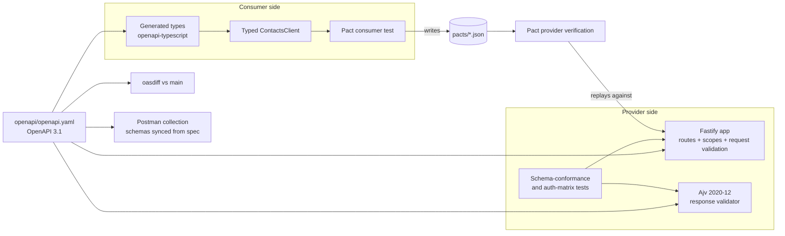

# api-contract-tests-ts

[](https://github.com/lana-20/api-contract-tests-ts/actions/workflows/ci.yml)
[Test report (Allure)](https://lana-20.github.io/api-contract-tests-ts/allure/) ·
[Newman report](https://lana-20.github.io/api-contract-tests-ts/newman/contacts-api.html)

Contract testing for a small REST API in TypeScript, with Vitest: checking an API's auth,
request and response shapes, and error codes **without** a full end-to-end environment.

The system under test is a tiny "contacts and messages" API ([Fastify](https://fastify.dev),
in [`src/`](src)) described by an **OpenAPI 3.1 spec**, [`openapi/openapi.yaml`](openapi/openapi.yaml),
which is the single source of truth:

- the app reads its routes, required scopes and request schemas from the spec
- TypeScript types are generated from it, so the client and handlers fail `tsc` if they drift
- every test layer below checks some part of the API against it

The API has bearer-token auth with scopes, CRUD, cursor pagination, validation errors,
401/403/404/409/422, RFC 9457 `application/problem+json` errors, and an `Idempotency-Key`
header on `POST /contacts/{id}/messages`.

## The layers

| # | Layer | Tool | Risk it covers | Cost | Tests |
|---|---|---|---|---|---|
| 1 | [Provider schema conformance](tests/schema-conformance) | Vitest + Ajv | A response that doesn't match the spec: wrong status, missing header, missing or undocumented field | ~0.5 s | 52 |
| 2 | [Auth and error-code matrix](tests/auth-matrix) | Vitest `test.each` | Missing scope checks, 401 vs 403 mix-ups, inconsistent error codes, leaked internals | ~0.6 s | 64 |
| 3 | [Consumer-driven contracts](tests/pact) | Pact V4 | Breaking a real consumer's usage | ~0.3 s; consumers maintain pacts | 7 interactions + verification |
| 4 | [Breaking-change detection](tests/breaking-changes) | oasdiff | A spec change that breaks existing clients | seconds; pure file diff | gate + self-test |
| 5 | [Property-based / fuzz](tests/property) | fast-check | Edge cases nobody wrote an example for; crashes on odd input | ~2 s | 4 properties, 330 cases |
| 6 | [Postman collections](postman) | Postman + Newman | The same contract, in the tool QA and other teams use; collection drift | ~2 s | 59 + 90 data-driven assertions |
| 7 | [GraphQL](graphql) | Apollo Server + Vitest + GraphQL Inspector | Schema drift, per-field auth, error shape, abusive queries | ~0.1 s | 21 + gate |

Plus static checks: ESLint, `tsc`, regenerated types must match the committed ones, and the
Postman collection must match the spec.

**Postman/Newman vs. the Vitest suites:** Postman fits a shared, exploratory,
manual-friendly collection that QA and developers both use. Code-based tests fit the CI
gate: exhaustive, fast, type-checked and reviewed like code. More in [`postman/`](postman#postmannewman-vs-the-vitest-contract-tests-when-each-one-fits).

## Why contract tests (the test-pyramid reasoning)

```
          /\      end-to-end: a few journeys through the real deployed stack
         /  \
        /----\    contract tests  <- this repo
       /      \
      /--------\  unit tests: functions and handlers in isolation
```

**Unit tests miss the boundary.** A unit test of a handler calls a function. It can't
tell you that the JSON on the wire has a renamed field, that a 403 came back as a 401,
that a header is missing, or that an internal field leaked. Those are exactly the things
the *other* side of the API depends on. Contract tests check the boundary itself, against
a written-down agreement (the spec, or a consumer's pact).

**End-to-end tests are the expensive way to find the same bugs.** To check one error code
end to end you need a deployed environment, real auth, real data, and every service in
between. They are slow, they share state (so they interfere with each other), and they
fail for reasons unrelated to the change (network, a neighbor's deploy, timing), which is
flakiness. When one fails, you still have to find which hop broke.

**Contract tests sit in between.** They run in milliseconds, in-process or against one
local server, with seeded data and a fresh app per test, so they are deterministic and
parallel-safe. They cover the whole matrix of statuses and auth cases, which is not
practical end to end. And a failure names the operation, status and field.

**They complement each other instead of overlapping:**

- *Schema conformance* checks the provider against its own spec: "do we do what we say?"
- *Pact* checks the provider against what each consumer actually uses: "do we still work for them?" It ignores fields no one uses, so the provider stays free to change them.
- *oasdiff* checks the spec against its previous version: "did we just promise something different?" It runs before any code.
- *Property-based tests* look for inputs no one thought to write down.

What they don't replace: a handful of end-to-end journeys (deploy wiring, config, the real
identity provider) and unit tests for business logic.

## How it fits together



## Run it locally

Requires Node 22 or later.

```bash
npm ci
npm test                 # all Vitest layers (Pact consumer runs before provider)
npm run test:schema      # one layer at a time:
npm run test:auth
npm run test:property    # FC_SEED=<seed> to replay a failure
npm run test:pact        # consumer, then provider verification
npm run test:graphql
npm run test:postman     # Newman, both collections, with HTML reports in reports/newman
npm run lint && npm run typecheck
npm run check:types-drift && npm run postman:check
tests/breaking-changes/self-test.sh   # needs oasdiff (brew install oasdiff) or Docker
graphql/breaking-self-test.sh
```

Try the API by hand:

```bash
npm start   # http://localhost:3000
curl -s localhost:3000/contacts -H 'Authorization: Bearer alice-token'
curl -si localhost:3000/contacts -H 'Authorization: Bearer alice-read-only' \
  -H 'Content-Type: application/json' -d '{"name":"Mary","email":"mary@example.com"}'   # 403
curl -si localhost:3000/contacts/c_1/messages -H 'Authorization: Bearer alice-token' \
  -H 'Idempotency-Key: 1' -H 'Content-Type: application/json' -d '{"body":"Hi"}'      # run twice
```

The demo tokens (in [`src/store.ts`](src/store.ts)) are `alice-token` (all scopes),
`alice-read-only`, `alice-expired`, `alice-no-scopes` and `bob-token`.

To see the report locally: `npx allure@3.33.0 generate allure-results -o allure-report && npx allure@3.33.0 open allure-report`.

## Test design choices

- **No sleeps, no shared state.** Every test gets a fresh app and a freshly seeded
  in-memory store. Servers that need a real port listen on port 0, so the OS picks a free
  one and parallel runs can't collide.
- **Deterministic data.** Ids are sequential per store, and time comes from an injected
  clock, so timestamps and token expiry never depend on when the test runs.
- **Test the tests.** The response validator, the oasdiff gate and the GraphQL Inspector
  gate each have a test proving they fail on a known-bad input. A check that never fails
  is worse than none.
- **One source of truth.** Routes, scopes, request validation, types, the Postman schemas
  and the conformance checks all come from the same spec, and CI fails on drift.

## CI

[`.github/workflows/ci.yml`](.github/workflows/ci.yml) runs each layer as its own job: static
checks, the three Vitest layers plus GraphQL (matrix), Pact consumer, then Pact provider
verification (using the consumer job's pact file), oasdiff, GraphQL Inspector and Newman.
A final job merges every job's Allure results into one report and publishes it, with the
Newman HTML reports, to [GitHub Pages](https://lana-20.github.io/api-contract-tests-ts).

## What I'd add at scale

- **A Pact Broker (or PactFlow)** with `can-i-deploy` before every deploy, webhooks that
  verify a provider when a consumer publishes a new pact, and `record-deployment` per
  environment. See [`tests/pact`](tests/pact#without-a-broker-this-repo-vs-with-a-pact-broker--pactflow).
- **Publish the spec as a versioned artifact**, so consumer teams generate their clients
  from a released version instead of a copy.
- **Spec linting** (Spectral or Redocly) with house rules: problem+json on every 4xx,
  operationIds, pagination conventions.
- **Contract tests against a deployed environment**: run the conformance checks as a
  post-deploy smoke test, or validate sampled production traffic against the spec.
- **Bi-directional contracts** (PactFlow), when a provider can't run Pact verification
  but can publish its spec.
- **Deprecation workflow**: `deprecated: true` plus a `Sunset` header first, and oasdiff
  configured to allow removal only after the sunset date.
- **Flake tracking**: retries off by default, and Allure history or a test-analytics tool
  to spot tests whose results change without a code change.

## Related

- [api-contract-tests-py](https://github.com/lana-20/api-contract-tests-py): the same ideas the Python way, with Schemathesis, Pydantic, Requests and pytest
- [backend-tests-py](https://github.com/lana-20/backend-tests-py): GraphQL (Strawberry), SQL across engines, MongoDB, document stores, Redis, and Linux servers over SSH

Author: [Lana Begunova](https://github.com/lana-20) · MIT License
