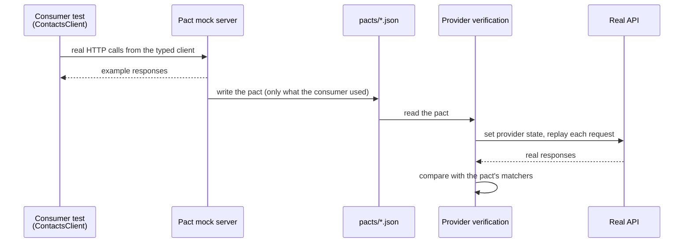

# Layer 3: consumer-driven contracts with Pact

**Question it answers:** will the API still work for *this particular consumer*?

The schema-conformance layer checks the provider against its own spec. Pact checks it
against what a real client actually uses, which is usually much less than the whole spec.

1. **Consumer** ([`consumer/`](consumer/contacts-client.pact.test.ts)): the real
   [`ContactsClient`](../../client/contacts-client.ts) runs against a Pact V4 mock server.
   Each interaction lists only the fields the client reads. Matchers (`regex`, `like`,
   `eachLike`) say "any value of this shape", so the provider can return different ids
   and timestamps. A passing run writes `pacts/contacts-web-contacts-api.json`.
2. **Provider** ([`provider/`](provider/contacts-api.pact.test.ts)): starts the real API
   on a random port, and Pact's `Verifier` replays every interaction. **Provider states**
   (`given('alice has a contact c_1')`) let the consumer name a situation and the provider
   set it up. Here each state resets the in-memory store to the seed data.

Run it: `npm run test:pact` (the consumer first, then the provider).

Try breaking it: in `src/handlers.ts`, rename `nextCursor` in `listContacts`. The
consumer tests still pass (they use the mock), and provider verification fails and
names the interaction and the missing field.

## Without a broker (this repo) vs. with a Pact Broker / PactFlow

Here the consumer and provider live in one repo, and CI hands the pact file from the
consumer job to the provider job as a build artifact. With separate repos and teams, a
broker replaces that hand-off:

1. Consumer CI publishes the pact, tagged with its git SHA and branch:
   `pact-broker publish pacts --consumer-app-version $GIT_SHA --branch $GIT_BRANCH`
2. Provider CI fetches the pacts it must satisfy with `consumerVersionSelectors`
   (for example `{ mainBranch: true }` and `{ deployedOrReleased: true }`), verifies
   them, and publishes the results (`publishVerificationResult: true`). The options are
   sketched in a comment in the provider test.
3. A webhook triggers provider verification when a consumer publishes a changed pact.
4. Before each deploy, both sides ask the broker whether that version is compatible with
   what is already in the target environment:
   `pact-broker can-i-deploy --pacticipant contacts-web --version $GIT_SHA --to-environment production`
   and then record it with `pact-broker record-deployment`.

`can-i-deploy` is what turns contract tests into a safe release process: it lets a
consumer or provider ship independently, without a shared end-to-end environment.

| | |
|---|---|
| **Risk covered** | Breaking a real consumer: a field the client reads is removed or changes type, a status it handles changes. |
| **Not covered** | Fields no consumer uses (by design), and anything outside the pact. |
| **Cost** | About 0.2 s here. The real cost is organizational: consumers have to write and maintain pacts, and you need a broker at scale. |
| **Flake risk** | Low. No shared environment; provider states make each interaction start from known data. |
